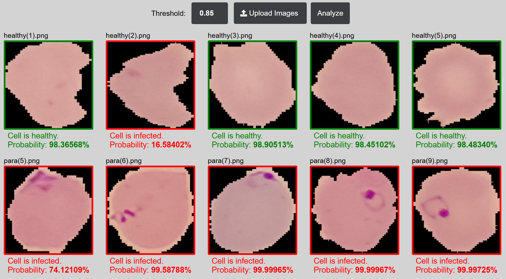
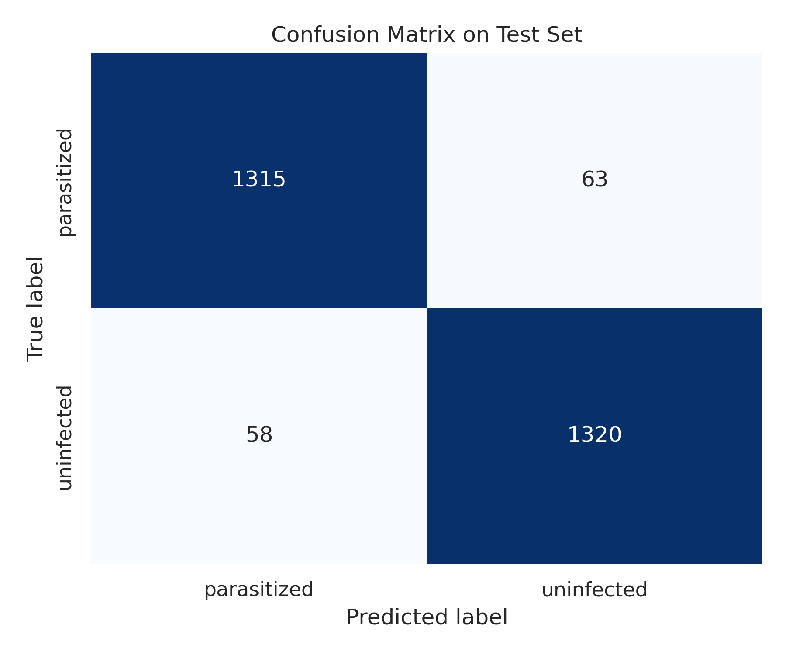
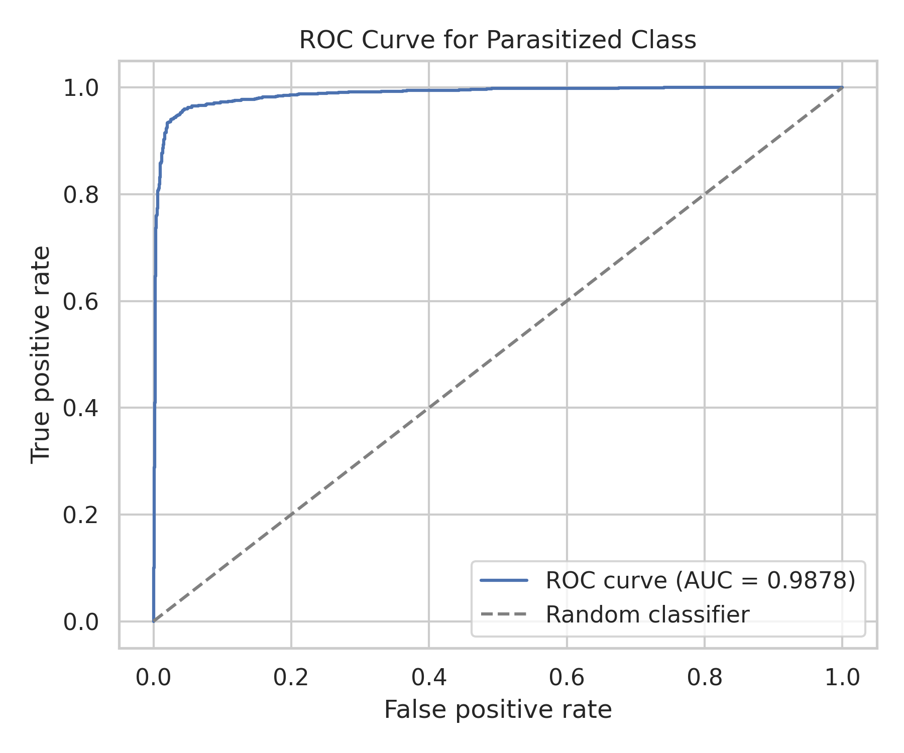
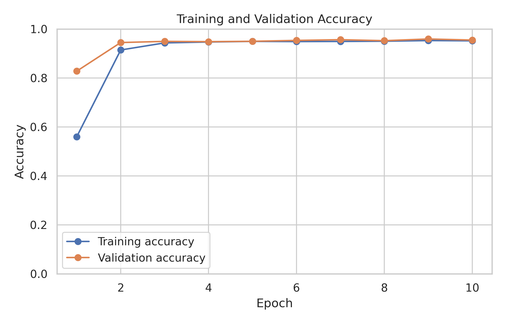
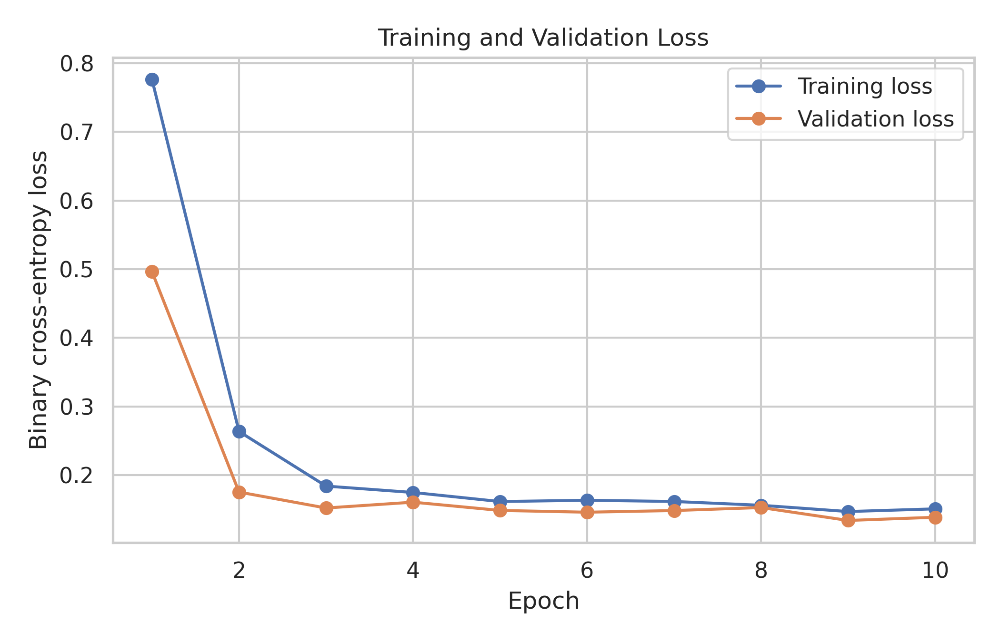

# Malaria DeepLearning

This repository contains the practical implementation for the bachelor thesis:

**Development of a Convolutional Neural Network and a Web Application for Classifying Human Cell Images Infected by Malaria.**

The project combines a web interface with a Convolutional Neural Network (CNN) trained to classify red blood cell images as healthy or infected. The application is intended as an educational and research prototype for the thesis.

[Repository](https://github.com/LgNNN/MalariaClassificationApp)



## What The Application Does

- Lets a user upload one or more microscope cell images through a browser interface.
- Sends the selected images to a Flask backend for CNN inference.
- Displays the predicted class and probability for each image.
- Allows the user to adjust the classification threshold from the frontend.
- Runs the frontend and backend as separate Docker services.

## Architecture

The application is split into two main services:

- **Frontend:** Node.js, Express.js, EJS, HTML, CSS, and JavaScript. It serves the user interface and sends uploaded images to the backend.
- **Backend:** Python, Flask, TensorFlow, and Gunicorn. It loads the trained `.keras` model and returns prediction results through an HTTP POST endpoint.

Docker Compose is used to run both services together during local development and demonstration.

## Repository Structure

```text
.
├── app
│   ├── backend          # Flask API and trained CNN model used for inference
│   ├── frontend         # Express/EJS frontend application
│   ├── docker-compose.yaml
│   └── docker-compose.prod.yaml
├── model_training       # Training and evaluation notebooks
├── test_images          # Small sample image set for trying the app
└── README.md
```

## Running The App With Docker

From the repository root:

```bash
cd app
docker compose up -d --build
```

Then open:

```text
http://localhost:3000
```

The frontend runs on port `3000`, and the backend API is exposed on port `5000`.

The default Compose file is intended for development and uses bind mounts with hot reload. For a cleaner public demo run without bind mounts, use:

```bash
cd app
docker compose -f docker-compose.prod.yaml up -d --build
```

## Backend URL Configuration

By default, the frontend sends prediction requests to:

```text
http://localhost:5000
```

This can be changed with the `BACKEND_URL` environment variable when starting the frontend service.

Example:

```bash
BACKEND_URL=http://localhost:5000 npm start
```

The Docker Compose file also defines `BACKEND_URL` for the frontend service so the browser can reach the backend through the exposed host port.

## Dataset

The model was developed using the **NLM-Falciparum-Thin-Cell-Images** dataset from the National Library of Medicine. The dataset contains segmented single-cell images from thin blood smear slides, including cells infected with *Plasmodium falciparum* and an equal number of uninfected cells.

The dataset contains **27,558 RGB images** in total, divided evenly into **13,779 parasitized cells** and **13,779 uninfected cells**. Each image represents a single red blood cell captured under a light microscope, with most images measuring around `150x150` pixels.

The full dataset is intentionally not committed to this repository because it is large and should be downloaded separately from its original source:

[National Library of Medicine: Malaria Dataset](https://lhncbc.nlm.nih.gov/LHC-research/LHC-projects/image-processing/malaria-datasheet.html)

The training notebooks expect the dataset to be available locally under:

```text
model_training/dataset/
```

## Results

The trained model was evaluated on a held-out test set of **2,756 images**. The evaluation outputs were generated in the model evaluation notebook.

| Metric | Value |
| --- | ---: |
| Test accuracy | 95.61% |
| Test loss | 13.46% |
| Parasitized precision | 95.78% |
| Parasitized recall | 95.43% |
| Parasitized F1-score | 95.60% |
| Macro F1-score | 95.61% |
| ROC-AUC for parasitized class | 98.78% |

The confusion matrix contained 1,315 correctly classified parasitized cells, 1,320 correctly classified uninfected cells, 63 parasitized cells classified as uninfected, and 58 uninfected cells classified as parasitized.









## Model

The backend includes the trained CNN model used by the application:

```text
app/backend/malariaNet-ep-10-fc-64-do-0.25-bs-32-test_acc-95.61.keras
```

The model is loaded when the Flask application starts, then reused for incoming prediction requests.

## Trying Sample Images

A small set of sample images is available in:

```text
test_images/
```

To test the application:

1. Start the app with Docker Compose.
2. Open `http://localhost:3000`.
3. Upload one or more images from `test_images/`.
4. Click **Analyze**.
5. Adjust the threshold value if you want to see how the displayed classification changes.

## Training And Evaluation

The `model_training/notebooks/` directory contains notebooks used for dataset preparation, CNN training, and model evaluation.
